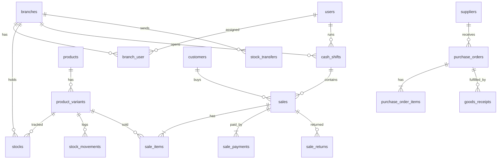

# Blueprint Aplikasi POS Retail Multi-Cabang

**Stack:** Laravel 13 · Inertia 3 · Vue 3 · Tailwind 4 · MySQL
**Paket fitur:** B (kasir + operasional toko), dengan Paket C (offline, QRIS, loyalty) menyusul
**Printer/Cash drawer:** QZ Tray (thermal 58mm, USB/Bluetooth)
**Perangkat:** PC kasir + barcode scanner

---

## 1. Ringkasan Kebutuhan

| Aspek | Keputusan |
|---|---|
| Jenis usaha | Retail |
| Cabang | Multi-cabang (stok dan laporan per cabang, owner melihat semua) |
| Pengguna | Owner, Admin, Kasir, Gudang |
| Pembayaran | Tunai dulu, struktur siap untuk QRIS/e-wallet |
| Diskon dan pajak | Ada (per item dan per transaksi, PPN) |
| Pelanggan | Opsional (transaksi tanpa pelanggan tetap bisa) |
| Struk | Thermal 58mm lewat QZ Tray |
| Hardware | Barcode scanner, cash drawer (lewat printer) |
| Laporan | Penjualan harian, laba rugi, produk terlaris; ekspor Excel dan PDF |
| Offline | Ditunda ke Paket C, tetapi database disiapkan sejak awal |
| Bahasa/mata uang | Indonesia / Rupiah |

**Persyaratan server:** PHP 8.3 atau lebih baru (disarankan 8.4), MySQL 8 / MariaDB 10.6+, Composer, Node.js 20+.

---

## 2. Hak Akses (Role)

| Role | Cakupan | Akses utama |
|---|---|---|
| Owner | Semua cabang | Semua fitur, laba rugi, pengaturan, manajemen user |
| Admin | Satu atau beberapa cabang | Produk, harga, promo, supplier, laporan cabang |
| Kasir | Satu cabang | Kasir, shift, hold, riwayat transaksi sendiri |
| Gudang | Satu cabang | Stok, penerimaan barang, opname, transfer, retur |

Aturan khusus:
- Void dan refund butuh otorisasi Admin (PIN atau login Admin).
- Kasir hanya melihat transaksi miliknya sendiri.
- Data selalu dibatasi per cabang sesuai `branch_user`, kecuali Owner.

---

## 3. Modul dan Fitur (Paket B)

### 3.1 Master Data
- Cabang, user, dan penugasan user ke cabang
- Kategori, satuan, produk
- Varian produk (ukuran, warna) dengan SKU dan barcode sendiri
- Satuan bertingkat (pcs, lusin, dus) dengan konversi
- Bundling/paket produk
- Supplier dan pelanggan

### 3.2 Inventori
- Stok per cabang per varian
- Stok minimum dan peringatan stok menipis
- Stok opname (hitung fisik, selisih, penyesuaian)
- Transfer stok antar cabang (kirim, terima, selisih)
- Retur ke supplier
- Riwayat mutasi stok (kartu stok)

### 3.3 Pembelian
- Purchase order (PO)
- Penerimaan barang (sebagian atau penuh)
- Hutang supplier dan pembayarannya
- Retur pembelian

### 3.4 Kasir (POS)
- Scan barcode atau cari produk dengan cepat
- Diskon per item dan per transaksi (nominal atau persen)
- Pajak (PPN) sesuai pengaturan
- Pembayaran tunai dengan hitung kembalian
- Hold dan lanjutkan transaksi
- Void dan refund dengan otorisasi
- Pilih pelanggan (opsional)
- Buka dan tutup shift (modal awal, hitung kas, selisih)
- Cetak ulang struk

### 3.5 Cetak dan Perangkat
- Struk 58mm (ESC/POS) lewat QZ Tray
- Buka cash drawer otomatis setelah pembayaran tunai
- Barcode scanner (mode keyboard)

### 3.6 Laporan
- Penjualan harian per cabang dan gabungan
- Produk terlaris
- Laba rugi (penjualan, HPP, laba kotor)
- Laporan stok dan nilai persediaan
- Kinerja kasir
- Ekspor Excel dan PDF

---

## 4. Rancangan Database

### 4.1 Daftar Tabel

**Akses**
- `branches`
- `users`
- `branch_user`
- `roles`, `permissions` (paket spatie/laravel-permission)

**Produk**
- `categories`
- `units`
- `products`
- `product_variants` (sku, barcode, harga modal, harga jual)
- `product_units` (konversi satuan)
- `bundle_items`

**Stok**
- `stocks` (saldo per cabang per varian)
- `stock_movements` (buku besar semua mutasi)
- `stock_opnames`, `stock_opname_items`
- `stock_transfers`, `stock_transfer_items`

**Pembelian**
- `suppliers`
- `purchase_orders`, `purchase_order_items`
- `goods_receipts`, `goods_receipt_items`
- `supplier_payments`
- `purchase_returns`, `purchase_return_items`

**Penjualan**
- `cash_shifts`
- `sales`, `sale_items`, `sale_payments`
- `sale_returns`, `sale_return_items`
- `held_sales`
- `discounts`
- `customers`
- `payment_methods`

**Sistem**
- `settings` (pajak, format struk, printer per cabang)
- `activity_logs`

### 4.2 ERD Inti



### 4.3 Prinsip Desain

1. **UUID dari sisi klien** pada setiap transaksi, sehingga mode offline nanti cukup menambah antrean sinkronisasi tanpa mengubah tabel.
2. **Stok tidak pernah diubah langsung.** Semua perubahan lewat `stock_movements` agar bisa diaudit. `stocks` adalah saldo hasil mutasi.
3. **Snapshot harga, diskon, dan pajak** disimpan di `sale_items`, sehingga laporan lama tidak berubah ketika harga produk diganti.
4. **Uang disimpan sebagai integer rupiah**, bukan desimal.
5. **`sale_payments` terpisah dari `sales`**, sehingga QRIS, e-wallet, dan split payment tinggal menambah metode.
6. **Soft delete** pada data master, dan **activity log** pada aksi sensitif (void, refund, penyesuaian stok, perubahan harga).
7. **Index** pada `barcode`, `sku`, `(branch_id, created_at)`, dan `(branch_id, variant_id)`.

---

## 5. Struktur Proyek

```
app/
├── Actions/                 # logika bisnis (satu aksi satu class)
│   ├── Sales/               # CreateSale, VoidSale, RefundSale, HoldSale
│   ├── Inventory/           # AdjustStock, TransferStock, CompleteOpname
│   ├── Purchasing/          # ReceiveGoods, ReturnToSupplier
│   └── Shifts/              # OpenShift, CloseShift
├── Http/
│   ├── Controllers/{Pos,Inventory,Purchasing,Reports,Settings}
│   ├── Middleware/          # BranchScope, EnsureOpenShift
│   └── Requests/
├── Models/
├── Policies/
└── Exports/                 # Excel dan PDF
database/
├── migrations/
└── seeders/
resources/js/
├── pages/{pos,products,inventory,purchasing,reports,settings}
├── components/
├── layouts/
└── lib/
    └── qz.ts                # koneksi QZ Tray, ESC/POS, buka laci
```

---

## 6. Integrasi QZ Tray

**Cara kerja:** QZ Tray dipasang di setiap PC kasir dan terhubung ke browser lewat WebSocket. Aplikasi mengirim perintah ESC/POS mentah ke printer thermal 58mm. Cash drawer terhubung ke port RJ11 printer dan dibuka dengan perintah pulse.

**Alur cetak:**
1. Transaksi selesai, server menyimpan `sale`.
2. Frontend membangun struk (ESC/POS) dari data transaksi.
3. QZ Tray mengirim ke printer, lalu mengirim perintah buka laci jika ada pembayaran tunai.

**Penandatanganan (signing):** tanpa sertifikat, QZ Tray menampilkan peringatan "untrusted" setiap kali mencetak. Ada dua opsi:
- Buat sertifikat sendiri dan pasang di tiap PC kasir (gratis).
- Beli sertifikat komersial dari QZ (lebih praktis untuk banyak PC).

Laravel akan menyediakan endpoint penandatangan (private key disimpan di server, bukan di frontend).

**Pengaturan per cabang:** nama printer, lebar kertas (58mm), jumlah karakter per baris, buka laci otomatis (ya/tidak), teks header dan footer struk.

---

## 7. Rencana Mode Offline (Paket C)

Tidak dikerjakan sekarang, tetapi desain sudah mengarah ke sana:

- PWA dengan service worker untuk cache aplikasi.
- IndexedDB menyimpan katalog produk dan antrean transaksi.
- Transaksi offline diberi UUID dan nomor lokal, lalu dikirim ke server saat online.
- Server menolak duplikat berdasarkan UUID (idempoten).
- Konflik stok diselesaikan lewat `stock_movements` (stok boleh minus sementara, lalu ditandai untuk dicek).

---

## 8. Tahapan Pengerjaan

| Fase | Isi | Hasil |
|---|---|---|
| 1 | Fondasi: install proyek, login, role, cabang, user | Aplikasi bisa login dan data dipisah per cabang |
| 2 | Master produk, varian, barcode, satuan, bundling | CRUD produk lengkap, import dan cetak label |
| 3 | Inventori: stok, opname, transfer, stok minimum | Kartu stok dan transfer antar cabang |
| 4 | Kasir: transaksi, diskon, pajak, hold, void/refund, shift, QZ Tray | POS siap dipakai di toko |
| 5 | Pembelian: PO, penerimaan, hutang, retur | Alur stok masuk dari supplier |
| 6 | Laporan dan ekspor Excel/PDF | Dashboard dan laporan lengkap |
| 7 | Pengujian, hardening, deployment | Panduan deploy ke hosting |
| C | Offline, QRIS/e-wallet, loyalty, piutang, API | Pengembangan lanjutan |

---

## 9. Paket Pendukung (Composer/NPM)

| Kebutuhan | Paket |
|---|---|
| Role dan permission | `spatie/laravel-permission` |
| Ekspor Excel | `maatwebsite/excel` |
| Ekspor PDF | `barryvdh/laravel-dompdf` |
| Activity log | `spatie/laravel-activitylog` |
| Barcode | `picqer/php-barcode-generator` |
| Grafik dashboard | `chart.js` + `vue-chartjs` |
| Cetak ESC/POS | `qz-tray` (NPM) |
| Pengujian | Pest |

---

## 10. Yang Dibutuhkan untuk Memulai Fase 1

- Versi PHP dan MySQL/MariaDB di hosting
- Nama aplikasi/toko dan jumlah cabang awal
- Persentase PPN yang dipakai (misalnya 11%) dan apakah harga jual sudah termasuk pajak
- Format nomor struk yang diinginkan (misalnya `INV/CAB01/20261123/0001`)
